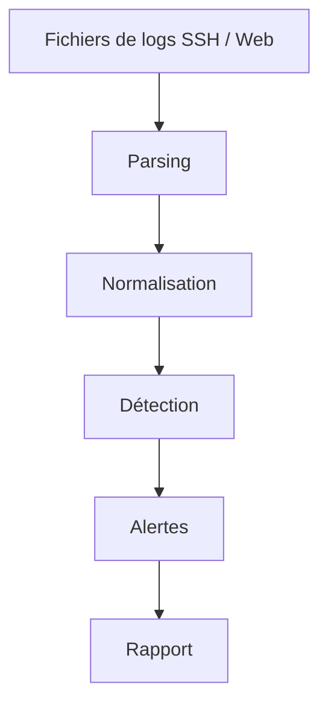

# Log Analysis & Threat Detection Tool

## 1. Présentation du projet

Outil Python qui prend en entrée des fichiers de logs SSH et Web (Apache/Nginx).

L'outil analyse et structure les événements présents dans ces fichiers, puis les compare à des règles pour identifier les activités suspectes et générer des alertes.

Une fonctionnalité personnelle sera la corrélation temporelle des échecs et des connexions SSH réussies, afin d'identifier le compte potentiellement compromis.

Projet à vocation pédagogique et défensive, limité à l'analyse de journaux provenant d'environnements autorisés.

## 2. Le flux de fonctionnement

